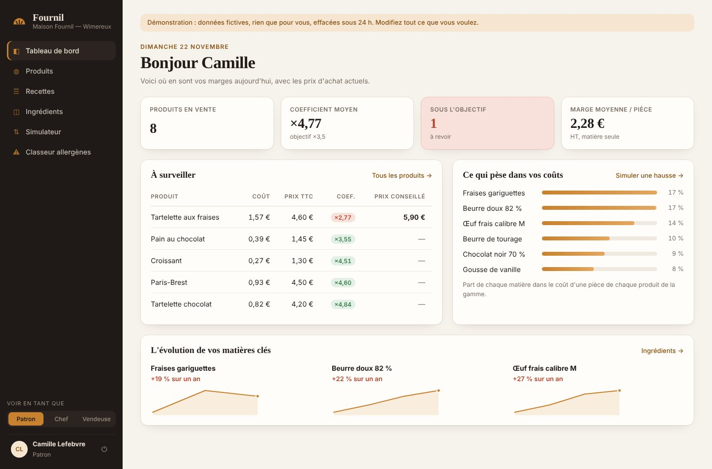
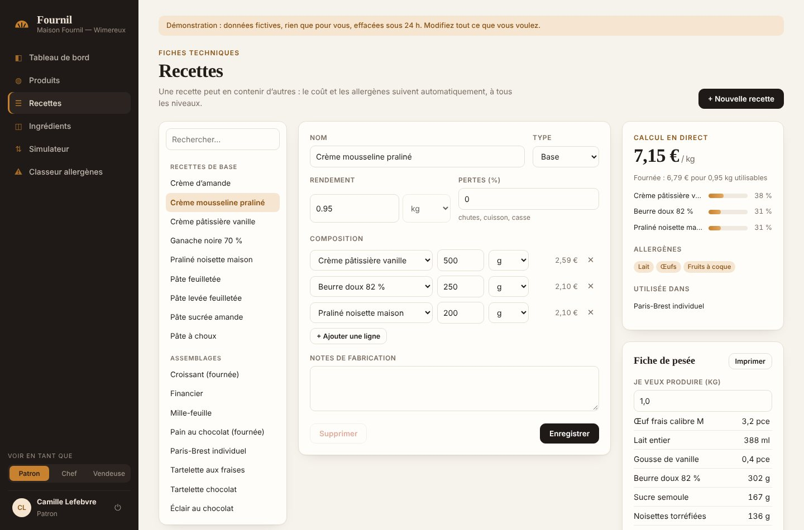
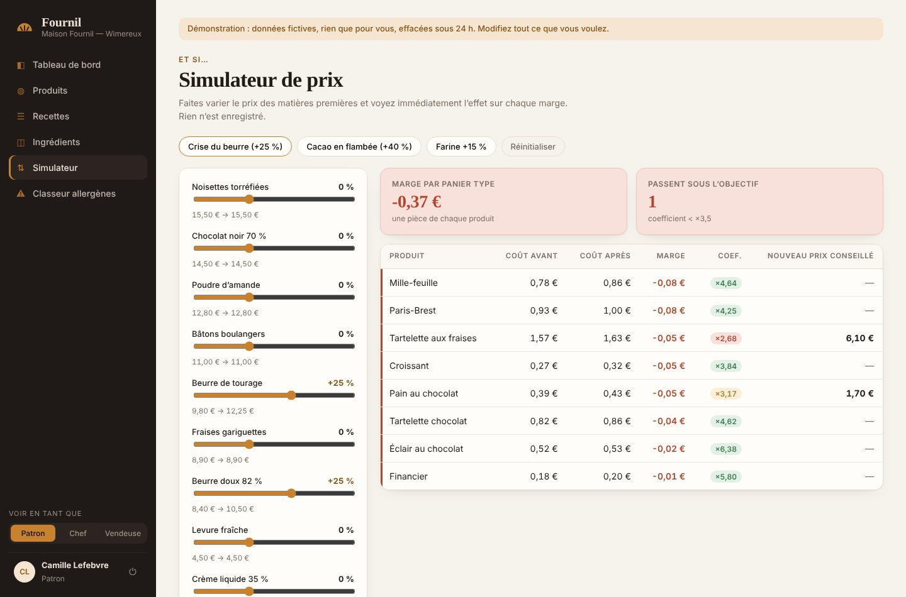
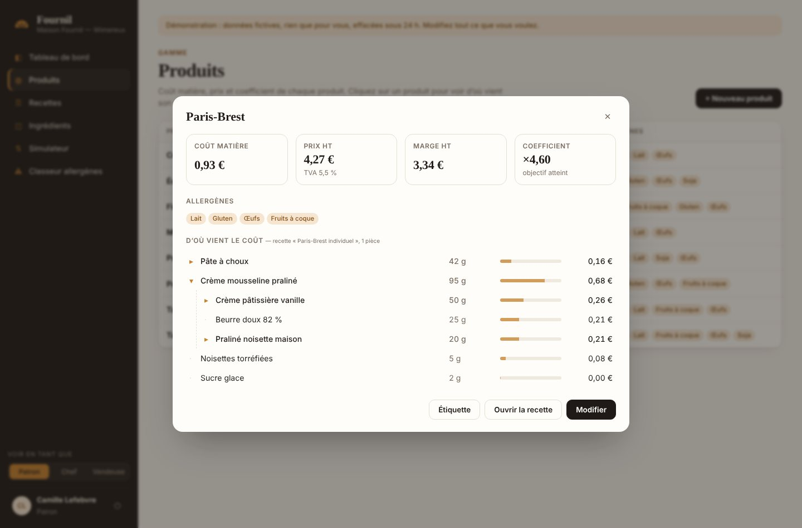
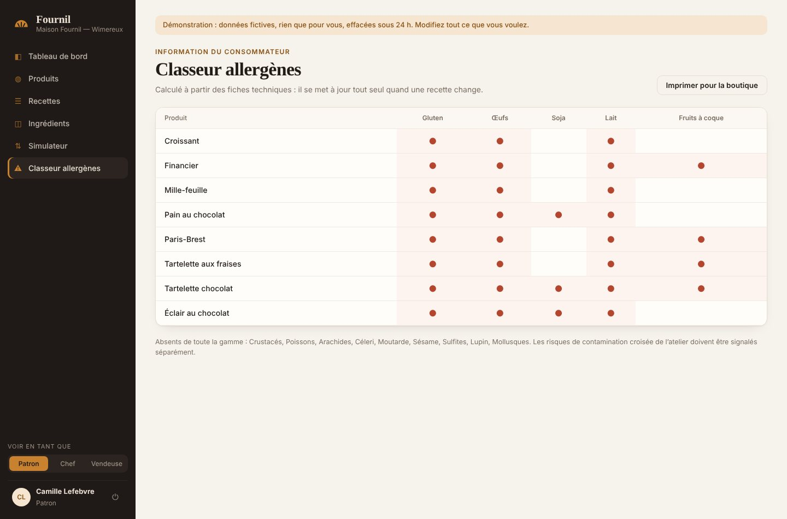

# Fournil — gestion de boulangerie-pâtisserie

> Fiches techniques, coût de revient, marges et allergènes INCO.
> Le beurre augmente ? Fournil vous dit tout de suite quels produits ne sont plus rentables.

**[▶ Essayer la démo](https://fournil.broutinjoelalain.workers.dev)** · une boulangerie fictive est créée rien que pour vous, avec 8 produits et 17 recettes.



Avant d'être développeur web, j'étais pâtissier. Calculer le vrai coût d'un mille-feuille, avec son feuilletage, sa crème pâtissière et les pertes, se fait encore souvent sur un coin de cahier. Le jour où le beurre prend 25 %, personne ne sait quels prix revoir. Fournil règle ça.

## Ce que fait l'application

| | |
|---|---|
| **Recettes imbriquées** | Une recette en contient d'autres, sans limite de niveaux : le feuilletage entre dans le mille-feuille, la crème pâtissière dans la mousseline qui entre dans le Paris-Brest. Coût et allergènes suivent à chaque étage. |
| **Coût de revient en direct** | Pendant qu'on modifie une fiche technique, le coût au kilo ou à la pièce se recalcule à chaque frappe, avec la part de chaque ingrédient. Les pertes (chutes, cuisson) sont prises en compte. |
| **Marges et prix conseillé** | Coût matière, prix HT, marge et coefficient par produit, avec le prix TTC à pratiquer pour atteindre le coefficient visé. |
| **Simulateur de hausse** | Des curseurs sur chaque matière première (« crise du beurre +25 % ») montrent l'effet sur chaque marge et les produits qui passent sous l'objectif. Rien n'est enregistré. |
| **Allergènes INCO** | Les 14 allergènes réglementaires remontent jusqu'au produit fini. On obtient un classeur allergènes imprimable pour la boutique et des étiquettes avec les ingrédients par ordre de poids et les allergènes en gras. |
| **Fiche de pesée** | « Je veux 60 croissants » : l'appli sort les quantités d'ingrédients bruts à peser, sous-recettes comprises. |
| **Historique des prix** | Chaque changement de prix est conservé, avec la liste des produits impactés. |
| **Trois rôles** | Le **patron** voit tout et fixe les prix. Le **chef** gère recettes et ingrédients. La **vendeuse** voit produits, allergènes et étiquettes : **aucun coût ne lui est envoyé par l'API**, pas seulement masqué à l'écran. |

<table><tr>
<td></td>
<td></td>
</tr><tr>
<td></td>
<td></td>
</tr></table>

## Architecture

```
┌──────────────────────────┐        ┌───────────────────────────────┐
│  React + Vite (SPA)      │  JSON  │  Cloudflare Worker (Hono)     │
│  calculs instantanés     │◀──────▶│  auth, rôles, validation      │──▶  D1 (SQLite)
└────────────┬─────────────┘        └──────────────┬────────────────┘
             └──────────┐            ┌─────────────┘
                   src/shared/domain.ts
          moteur métier pur, testé, partagé par les deux
```

- **Un seul moteur métier** (`src/shared/domain.ts`), sans aucune dépendance : coût récursif avec mémoïsation, détection des recettes circulaires, propagation des allergènes, conversions d'unités, simulation. L'interface l'utilise pour calculer en direct. L'API l'utilise pour valider : une recette qui s'utiliserait elle-même est refusée des deux côtés.
- **Cloisonnement multi-boutiques** : chaque requête SQL est filtrée par boulangerie, et chaque référence (ingrédient, sous-recette) est vérifiée avant écriture.
- **Sécurité** : mots de passe hachés en PBKDF2-SHA256 (100 000 itérations, sel aléatoire, comparaison à temps constant). Sessions par cookie `HttpOnly` / `SameSite=Lax`, et seule l'empreinte SHA-256 du jeton est stockée. En-têtes de sécurité HTTP. Message d'erreur identique que l'email existe ou non.
- **Démo isolée** : chaque visiteur reçoit sa propre boulangerie. Une tâche planifiée (cron) supprime chaque nuit les démos de plus de 24 h et les sessions expirées.
- **Intégrité** : contraintes `CHECK` et clés étrangères en base, écritures groupées en transactions D1 (`batch`).

| Couche | Choix |
|---|---|
| Interface | React 19, React Router, TypeScript strict, CSS sur mesure (pas de framework UI) |
| API | Hono sur Cloudflare Workers |
| Base | Cloudflare D1 (SQLite), migrations versionnées |
| Tests | Vitest : 15 tests sur le moteur métier (coûts vérifiés à la main, cycles, allergènes, simulation…) |
| CI | GitHub Actions : typage, tests, build à chaque push |

## Lancer en local

```bash
git clone https://github.com/as9ardth0r/fournil.git
cd fournil
npm install
npm run db:migrate      # crée la base D1 locale
npm run dev             # http://localhost:5173, cliquez sur « Essayer la démo »
npm test
```

Créer un vrai compte (hors démo) :

```bash
npm run create-account -- "Boulangerie du Port" patron@exemple.fr "Prénom Nom"
```

## Déployer sur Cloudflare (gratuit)

```bash
npx wrangler login
npx wrangler d1 create fournil          # copiez le database_id affiché dans wrangler.jsonc
npm run deploy                          # build + migrations distantes + déploiement
npm run create-account -- "Ma boulangerie" moi@exemple.fr "Mon Nom" --remote
```

## Feuille de route

- [x] Fiches techniques, coûts, marges, allergènes, étiquettes, simulateur, rôles
- [ ] Planning de production : commandes du jour → liste de fabrication par poste (tour, four, finition)
- [ ] Stocks et commandes fournisseurs avec alertes de rupture
- [ ] Commandes clients spéciales (pièces montées, gâteaux d'anniversaire)
- [ ] Export PDF des fiches techniques

## Limites assumées

Les compositions et prix de la démo sont réalistes mais fictifs. La liste d'ingrédients des étiquettes est générée automatiquement (une pièce, comme un œuf, est comptée 50 g) et doit être validée par le professionnel avant affichage, tout comme la mention des traces éventuelles.

---

**Joël Broutin**, développeur web freelance à Wimereux, pâtissier de formation.
[Portfolio](https://as9ardth0r.github.io/portfolio/) · Disponible pour vos applications métier sur mesure.

Licence MIT.
